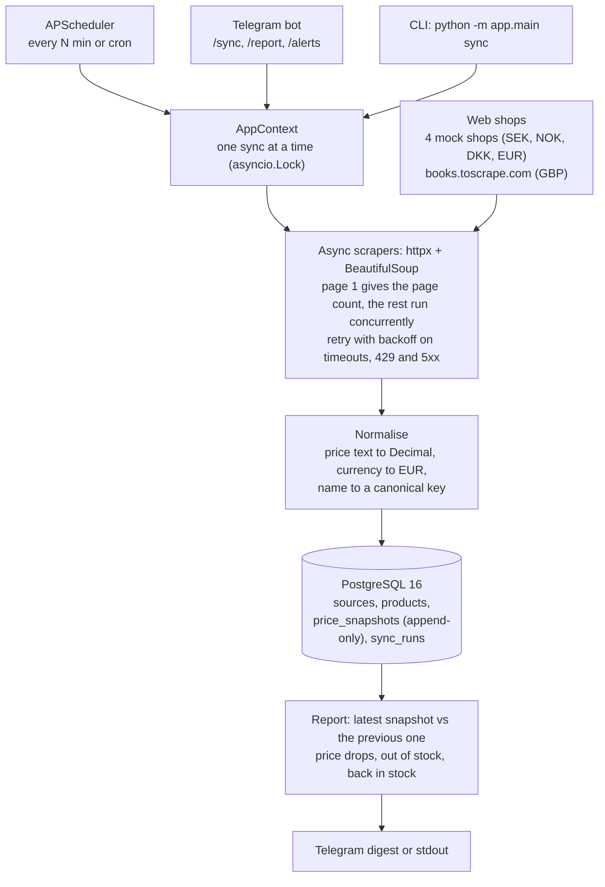

# Nordic Price Aggregator

[](https://github.com/Darlinglove002/nordic-price-aggregator/actions/workflows/ci.yml)



Async scraper that collects prices and stock levels from several web shops on a schedule
(or on a Telegram command), normalises currencies and product names, keeps the full price
history in PostgreSQL, and sends a digest to Telegram: **what got cheaper, what ran out,
what is back in stock.**

**Stack:** Python 3.12 · httpx · BeautifulSoup 4 · SQLAlchemy 2 (async) · PostgreSQL 16 ·
Alembic · aiogram 3 · APScheduler · Docker Compose

## Quick start

```bash
cp .env.example .env          # set TELEGRAM_BOT_TOKEN and ALLOWED_CHAT_IDS (optional)
docker compose up -d --build  # app + PostgreSQL + mock shops; migrations run on start
docker compose exec app python -m app.main sync   # one-off sync, report printed to stdout
```

Without a bot token the scheduler still runs and you can use the one-off command above.
To see changes without waiting for real price moves, advance the mock shops and sync again:

```bash
curl -X POST http://localhost:8099/_admin/advance
docker compose exec app python -m app.main sync
```

### Telegram commands

| Command   | What it does                                                          |
|-----------|-----------------------------------------------------------------------|
| `/sync`   | scrape every source now, then show the report                         |
| `/report` | drops / out-of-stock / back-in-stock since each product's previous snapshot |
| `/alerts` | toggle the scheduled digest for this chat                             |

The bot is **deny-by-default**: only chat ids listed in `ALLOWED_CHAT_IDS` get an answer
(an unknown chat is told its own id so you can add it).

## Example Request & Response

The one-off command runs a full sync and prints the digest. Diagnostics go to stderr and the report to stdout, so `python -m app.main sync > report.txt` captures the report and nothing else. This is a real run against the four mock shops and books.toscrape.com, made after advancing the mock shops once (`curl -X POST http://localhost:8099/_admin/advance`) so that there are changes to report:

```bash
python -m app.main sync          # in the compose stack: docker compose exec app python -m app.main sync
```

stderr, the log (sources are scraped concurrently and stored one by one, so the first line per source appears only after the slowest source has finished):

```text
2026-11-20 22:43:07,578 INFO    app.services.sync: sync #3 started (manual), 5 sources
2026-11-20 22:43:15,086 INFO    app.services.sync: fjordtech: stored 554 items (28 pages, 0 failed)
2026-11-20 22:43:15,153 INFO    app.services.sync: nordvik: stored 529 items (27 pages, 0 failed)
…
2026-11-20 22:43:15,422 INFO    app.services.sync: sync #3 ok: 3146 items in 7.9s
```

stdout, the report (trimmed after two of 388 drops):

```text
Sync #3: ok — 3146 items in 7.9s
✓ fjordtech: 554
✓ nordvik: 529
✓ danskgear: 543
✓ suomishop: 520
✓ books-toscrape: 1000
Price report · run #3 · 3146 products tracked

Price drops (388)
▼ Mouse Anker MX-2708XM (White) — DanskGear
   845.00 → 634.00 DKK (−25%, ≈ €84.82)
▼ Xiaomi MX-6434X Mouse, Red — FjordTech
   1086.00 → 816.00 SEK (−25%, ≈ €72.78)
…
```

The same command right before the shops changed (run #2) prints `No price drops or stock changes.` after the same per-source lines. The wall-clock time above includes the real site and a Windows host, so it is not comparable with the sync-vs-asyncio benchmark below, which uses only the mock shops.

## Data sources

* **Four mock Nordic shops** (`mock_shop/`, an aiohttp app): different currencies
  (SEK/NOK/DKK/EUR), price formats (`1 299,00 kr`, `NOK 1,299.00`, `1.299,00 kr.`), name
  styles, assortments, simulated latency and optional random 503s. Prices and stock change
  when you advance the mock's "epoch", so the pipeline has real changes to find.
* **[books.toscrape.com](https://books.toscrape.com)**: a public sandbox built for scraping
  practice; 1000 items, GBP.

## Design decisions

* **Page 1 first, then everything else concurrently.** Page 1 reveals the page count; the
  remaining pages run under a per-source semaphore. Failed pages are counted, not fatal:
  one bad page does not discard the other 49.
* **Retry only what is worth retrying.** Timeouts, connection errors, 429 and 5xx get
  exponential backoff with jitter; 404 and other 4xx fail immediately.
* **A source failing never blocks the others.** Each source is stored in its own
  transaction. A run is `ok`, `partial`, or `failed` (nothing stored).
* **Price drops are compared in the shop's own currency**, never in EUR, so a moving
  exchange rate cannot masquerade as a discount (there is a test for exactly this).
  EUR values (live ECB rates with a built-in fallback table) are for display and
  cross-shop comparison.
* **The report only considers products seen in the latest run.** Otherwise a page that
  failed to scrape would make an old price drop look new (also tested).
* **Name normalisation** lets the same product from different shops share a key:
  accent folding (including `ø`/`æ`), `WH-1000XM5` ≡ `WH1000XM5`, noise words dropped,
  tokens sorted. A test checks that all four mock shops' spellings collapse to one key.
* **History is append-only**: one `price_snapshots` row per product per run.
* **Scraped HTML is untrusted input.** Names are HTML-escaped in Telegram messages, only
  `http(s)` URLs become links, and oversized strings are clipped or skipped instead of
  failing the whole insert.
* **Operational safety:** the container runs as a non-root user, DB and mock-admin ports
  bind to `127.0.0.1` only, secrets come from `.env` (git-ignored), and the bot token is
  kept out of logs.

## Benchmark: synchronous vs asyncio

Same parsers, same catalogue (4 shops, 109 pages, 2146 items); only the I/O strategy differs.
The mock adds ~250 ms latency per request, so **absolute numbers say nothing about real
sites. The ratio is the point.** Median of 3 runs, inside Docker (Linux), no injected failures.

| Variant                          | Time    | Speed-up |
|----------------------------------|--------:|---------:|
| sync (`httpx.Client`, sequential)| 27.96 s |     1.0× |
| async, 1 concurrent request/shop |  7.27 s |     3.8× |
| async, 5 concurrent / shop       |  1.84 s |    15.2× |
| async, 10 concurrent / shop      |  1.28 s |    21.9× |
| async, 20 concurrent / shop      |  1.19 s |    23.4× |

Reproduce: `docker compose --profile bench run --rm bench`. Gains flatten past ~10 because
the fixed cost (page 1 first, then one more round trip) dominates. Real sites will also
rate-limit, so `SCRAPE_CONCURRENCY` defaults to a polite 10.

## Tests

```bash
python -m venv .venv && .venv/Scripts/activate   # or source .venv/bin/activate
pip install -e ".[dev]"
pytest
```

53 offline tests (no network, SQLite in a temp file): price-format parsing, name
normalisation, HTML parsers against fixtures (including malformed cards and layout change),
retry/backoff via `httpx.MockTransport`, the end-to-end sync → report flow including the
failure cases listed above, the bot's deny-by-default access control (driven with fake
Telegram updates), and the logging and stdout/stderr split of the one-off command. Migrations are additionally verified against real PostgreSQL
(`alembic check` reports no drift between models and migration). CI runs ruff, mypy and the
suite on Python 3.11 and 3.12.

## Configuration

See [`.env.example`](.env.example). Highlights: `SYNC_CRON` / `SYNC_INTERVAL_MINUTES`,
`SCRAPE_CONCURRENCY`, `HTTP_RETRIES`, `MIN_DROP_PERCENT` (default 1 %), `FX_REFRESH`, `LOG_LEVEL`.

## Limitations

* Products are matched across shops by normalised name, which works for model-coded goods
  but is not a general product-matching solution (no GTIN/EAN).
* No per-site politeness beyond a concurrency cap (no robots.txt handling, no per-host
  rate limit): fine for the bundled sandboxes, add both before pointing it at real shops.
* `/report` always shows the last run versus the one before it; there is no history query
  or price chart yet.
